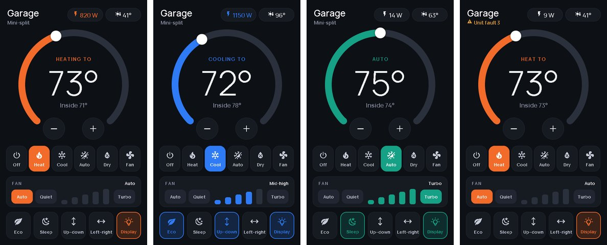
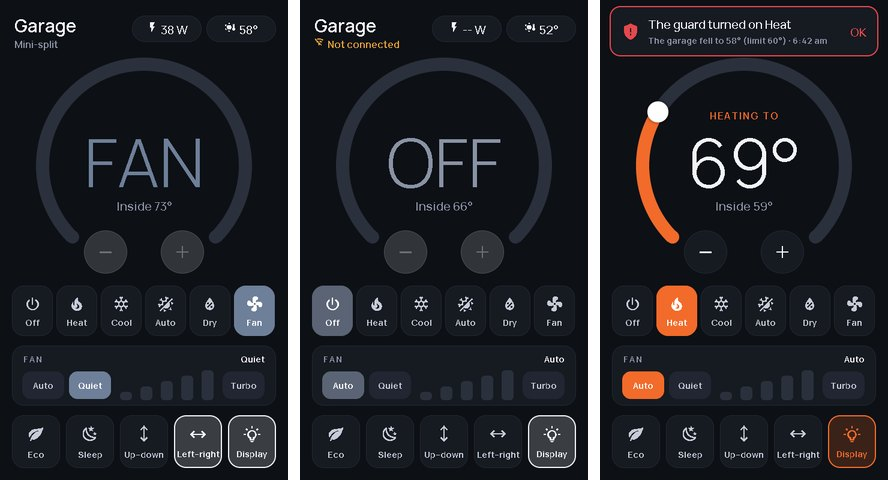
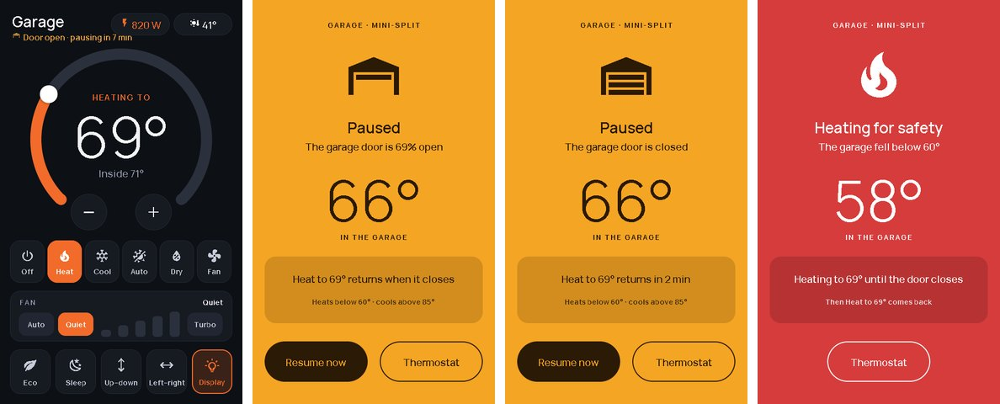
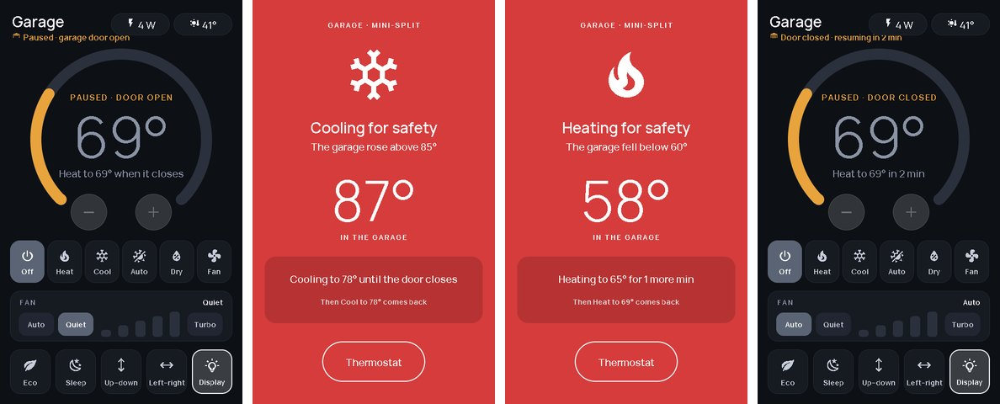

# Thermostat Panel

A wall thermostat for a Pioneer WYT mini-split running this repository's component: a Waveshare
ESP32-S3-Touch-LCD-4.3 in portrait, talking to the mini-split through Home Assistant.





## What It Shows

- A dial with the setpoint (- and + in its opening), the indoor temperature, and chips for the power draw (in the
  mode's colour while the unit runs) and the outdoor temperature
- Modes: Off, Heat, Cool, Auto, Dry, Fan
- Fan: Auto, Quiet, five speeds and Turbo
- Tiles for Eco, Sleep, the up-down and left-right louvers, and the unit's display
- Whether the outdoor unit is running or idle, a unit fault, and "Not connected" while Home Assistant or the
  mini-split is away
- A screen saver: the backlight goes off after a timeout with no touch, and a touch wakes it

The setpoint moves one whole °F at a time (61-89 °F), for a mini-split set up with `fahrenheit: true`.

### With the garage-safety branch

If the mini-split runs the [`garage-safety`](https://github.com/rog713/pioneer-wyt-esphome/tree/garage-safety)
package, the panel also shows it: the countdown while the garage door is open, a full amber screen while the unit is
paused (with Resume now), the countdown once the door has closed again, a full red screen while it heats or cools for
safety, and a card when the temperature guard turns the unit on. Without that package these entities don't exist and
the door screens never appear.





## Hardware

- Waveshare ESP32-S3-Touch-LCD-4.3 (800 x 480 RGB panel, GT911 touch, CH422G expander), mounted in portrait.
  `screen_rotation` is 90 or 270, depending on which way up it hangs.
- A 5 V supply of at least 2 A. On a weak USB port the board can brown out when the backlight switches on.
- The backlight on this board is on or off only (no dimming).

## Setup

1. Copy this folder, then `secrets.yaml.example` to `secrets.yaml` with your values.
2. In `thermostat-panel.yaml`, set the substitutions to your mini-split's entities as Home Assistant names them
   (Settings > Devices > your mini-split): the climate entity, indoor and outdoor temperature, power, fault and the
   five switches. `room_name` is the name at the top of the screen.
3. Flash it over USB the first time: `esphome run thermostat-panel.yaml`. After that, updates go over Wi-Fi.
4. Add the panel in Home Assistant, then in its ESPHome device options turn on **Allow the device to perform Home
   Assistant actions**, or the buttons change nothing.

Built and tested with ESPHome 2026.7.4.

The panel adds these entities to Home Assistant: *Screen saver* (switch), *Screen saver timeout* (minutes), *Screen*
(the backlight), *Wi-Fi signal* and *Uptime*.

## Preview on a Computer

`mock.yaml` runs the same screen (`ui.yaml`) in a window, using ESPHome's host platform and SDL2 (`brew install sdl2`,
or `libsdl2-dev` on Linux). Nothing is sent anywhere.

```bash
esphome run mock.yaml
```

To save one screenshot of each state and exit, run the built program with `MOCK_SNAPSHOT_DIR=<folder>` set
(and `SDL_VIDEODRIVER=dummy` for no window). The pictures in `images/` were made this way.

## Files

| File | What |
|---|---|
| `thermostat-panel.yaml` | the board: display, touch, backlight, Wi-Fi, and the Home Assistant link |
| `ui.yaml` | the screen, shared by the board and the preview |
| `mock.yaml` | the preview on a computer |
| `secrets.yaml.example` | the secrets the board needs |
